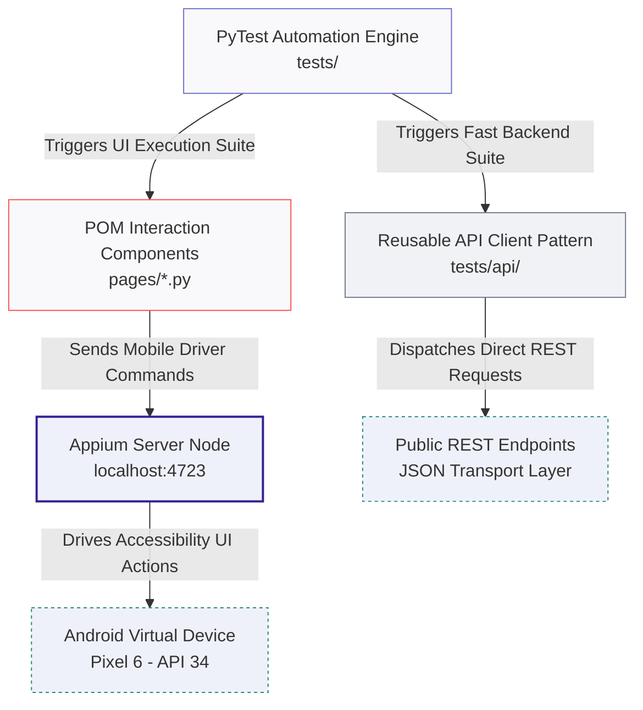

# 🤖 Android Appium Pytest Framework

[](https://github.com)
[](https://appium.io)
[](https://pytest.org)

---

## 🎯 About The Project
This repository hosts a high-performance, enterprise-grade mobile automation framework built from scratch using **Python**, **Appium (UiAutomator2)**, and **PyTest** utilizing strict **Page Object Model (POM)** design patterns. The testing suite validates end-to-end user workflows against the Sauce Labs `"My Demo App RN"` native Android application package.

The framework features a decoupled architectural strategy, allowing developers to execute heavy UI end-to-end checks via virtual device emulators alongside fast, lightweight backend integration validation suites via an independent API client manager.

### 🛠️ Technology Stack Breakdown
* **Mobile Driver Core:** Appium Server + UiAutomator2 (Native Android accessibility hook controls and gesture manipulation)
* **Test Architecture Runner:** PyTest Engine Suite (Dynamic parameter distribution maps, custom hooks, and isolated test fixture lifecycles)
* **Design Pattern Structure:** Page Object Model - POM (Total separation of UI element locators from verification validation assertions)
* **Backend Validation Layer:** Python Requests Core (Multi-endpoint JSON body parsing client running independently from hardware drivers)

---

## 🕹️ Interactive Navigation
* [🏗️ Multi-Layered Test Runner Architecture](#-multi-layered-test-runner-architecture)
* [📋 Framework Component Matrix](#-framework-component-matrix)
* [📂 Directory Blueprint](#-directory-blueprint)
* [🚦 Local Command-Line Execution](#-local-command-line-execution)
* [⚙️ Cloud CI/CD Automation Pipeline](#️-cloud-cicd-automation-pipeline)

---

## 🏗️ Multi-Layered Test Runner Architecture



---

## 📋 Framework Component Matrix

| Framework Component Module | Target Test Layer | Operational Scope & Strategy |
| :--- | :--- | :--- |
| **PyTest Automation Core** | Test Orchestration | Manages execution states, hooks parameterized variables, and handles driver instantiation fixtures. |
| **Page Objects Layer (POM)** | Mobile UI Abstraction | Maps element selectors (XPaths, Resource IDs) and wraps complex interaction operations. |
| **Python Requests Engine** | Independent API Layer | Executes fast backend integration validations, skipping emulator boots entirely. |
| **Appium UiAutomator2 Node** | Hardware Automation Core | Translates high-level locator actions into system-level UI instructions on the device. |
| **Android Emulator Core** | Virtualization Target | Hosts the native mobile app package runtime environment (Pixel 6, Android API 34). |

---

## 📂 Directory Blueprint

```text
android-appium-pytest-framework/
├── .github/workflows/
│   └── appium-ci.yml          # Cloud CI/CD Android Emulator Runner engine workflow
├── pages/                     # Page Object Model Layer: Abstracts locators and actions
│   ├── base_page.py           # Core explicitly synced waiter rules and action wrappers
│   ├── login_page.py          # Secure profile access locators and fields entry
│   └── product_page.py        # Catalogue views navigation and item checkout matrices
├── tests/                     # Validation Execution Suites
│   ├── api/                   # Isolated backend endpoint checking matrix scripts
│   ├── conftest.py            # Reusable page fixture maps and emulator capabilities
│   └── test_mobile_ui.py      # E2E mobile UI views regression validation scenarios
├── pytest.ini                 # PyTest runner execution flags, tracking tags, and paths
└── requirements.txt           # Python application dependency configuration manifests
```

---

## 🚦 Local Command-Line Execution

### 1. Execute Comprehensive Mobile UI Verification Suite
Ensure your target Android Studio Emulator engine is open and listening locally alongside your Appium Server node before triggering tests:
```bash
# Set up dependencies locally
python3 -m venv venv
source venv/bin/activate
pip install -r requirements.txt

# Run complete UI regression suite
pytest tests/ -v
```

### 2. Run Isolated API Backend Tests (Fast Execution Mode)
Runs independently of the mobile UI framework. Does not require an active Android emulator or background Appium driver session:
```bash
pytest tests/api/ -v
```

---

## ⚙️ Cloud CI/CD Automation Pipeline

This framework features a preconfigured **GitHub Actions** orchestration engine (`appium-ci.yml`). Every codebase push or validation request spins up an isolated server that handles system compilation checks dynamically:

```yaml
name: Appium Android Tests

on:
  push:
    branches: [ main ]
  pull_request:
    branches: [ main ]

jobs:
  test:
    runs-on: macos-latest
    steps:
      - uses: actions/checkout@v4

      - name: Set up Python
        uses: actions/setup-python@v5
        with:
          python-version: '3.11'

      - name: Install Python dependencies
        run: |
          python -m pip install --upgrade pip
          pip install -r requirements.txt

      - name: Set up Node.js
        uses: actions/setup-node@v4
        with:
          node-version: '20'

      - name: Install Appium Core & Drivers
        run: |
          npm install -g appium
          appium driver install uiautomator2

      - name: Enable KVM Core Hardware (Android Emulator Optimization)
        run: |
          echo 'KERNEL=="kvm", GROUP="kvm", MODE="0666", OPTIONS+="static_node=kvm"' | sudo tee /etc/udev/rules.d/99-kvm4all.rules
          sudo udevadm control --reload-rules
          sudo udevadm trigger --name-match=kvm

      - name: Boot Android Emulator & Execute PyTest Suite
        uses: reactivecircus/android-emulator-runner@v2
        with:
          api-level: 34
          target: google_apis
          arch: x86_64
          script: |
            appium &
            sleep 10
            pytest -v
```
